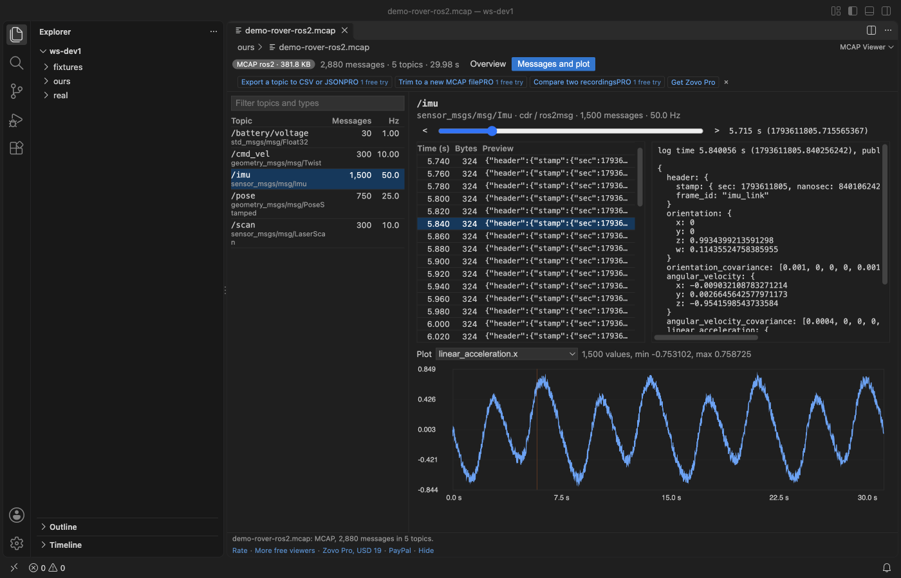

# MCAP Viewer & ROS Bag Viewer

Open MCAP recordings (.mcap) and ROS 1 bags (.bag) in VS Code: see the topics, read the decoded messages, seek in time and plot a field. Made by Zovo.

Free, with no account and no network calls:

- Opens .mcap files (any profile: ROS 1, ROS 2 or none) and ROS 1 .bag files (format 2.0). Chunks may be uncompressed, LZ4 or zstd (MCAP), or LZ4 or bz2 (bag).
- Recording facts: start and end time, duration, message count, size, the library that wrote the file, chunk count, compression and ratio, schemas with their text, metadata records and attachments.
- Topics with their message type, encoding, message count, rate in Hz, and first and last time.
- Messages of a topic, 50 per page, with every field decoded from the schema inside the file: ROS 1 (ros1msg), ROS 2 CDR (ros2msg and ros2idl), JSON and protobuf. Other encodings show the first bytes in hex.
- A time slider and page buttons to seek to any moment of the recording.
- A plot of one number field of a topic over the whole recording. Click the plot to seek there.

Zovo Pro: USD 19 once, for the Pro tools in every Zovo extension. Each Pro tool has 1 free try on your computer first:

- Export a topic to CSV, JSON or JSON Lines, with the log time of every message. CSV gets one column per field.
- Trim to a new MCAP file: pick the topics and a time range, and the messages are copied byte for byte with their schemas. A ROS 1 bag becomes an MCAP file this way.
- Compare two recordings topic by topic: topics only in one file, type changes, message counts and rates. Save the report as Markdown or CSV.

## How to use it

- Click a .mcap or .bag file in the Explorer. It opens in the viewer with the Overview tab: the recording facts, the topic table, the schemas, metadata and attachments.
- Click a topic (in the list on the left or in the topic table) to open Messages and plot. Click a message to read all its fields. Use the arrow keys in the list, the < and > buttons for the page before or after, and the slider to jump in time.
- The plot below the messages shows one number field over the whole recording. Pick another field in its list. The orange line marks the message you picked.
- To try it without your own files, run MCAP Viewer: Open the Sample Recording (MCAP, ROS 2) or Open the Sample ROS 1 Bag from the Command Palette.
- The Pro tools are in the Command Palette (MCAP Viewer: ... (Pro)), in the Explorer right-click menu of a .mcap or .bag file, in the viewer's title bar menu and in the small row at the end of the viewer toolbar. The row closes with its x for the rest of the session, and the setting `mcapViewer.showProTools` hides the Pro tools for good.

## Details

- Large files: an MCAP file with a summary section and a bag are read by ranges through their indexes, so a page of messages reads only the chunks it needs. Where the file has message index records, the rates come from them without decompressing any chunk.
- An MCAP file without a summary section (for example one that was still being written) is read in full, up to 1 GB, and the view says so. An MCAP file that ends early shows the messages before the cut.
- Long arrays (images, point clouds, laser ranges) show their first 64 items in the message view. The plot reads up to 500,000 messages of a topic and keeps the lowest and highest values when it thins them out to about 4,000 points.
- CSV export: arrays of up to 64 items get one column per item; longer arrays go into one cell as JSON, and arrays longer than 4,096 items are written as their type and length (for example uint8[921600]). JSON export follows the same 4,096 limit.
- Trim writes LZ4-compressed chunks with a full index. It keeps the metadata records and the attachments whose log time is in the range.
- Compare reads the two summaries: topics are matched by name, and a rate counts as changed when it differs by more than 10 %. Message contents are not compared.

## Not supported

ROS 2 .db3 bags (SQLite), ROS bags in the old 1.2 format (run `rosbag fix` first) and encodings other than the four above (shown as bytes). A bag that was not closed has no index: run `rosbag reindex` on it. Files on a remote file system open only up to 1 GB.

## Privacy

The extension reads the files you open and nothing else. It makes no network calls, and nothing is uploaded or measured. The Pro tools write only the files you ask for. The links at the bottom of the viewer (Rate, More free viewers, Zovo Pro, PayPal) open a page only when you click them, and the setting `mcapViewer.showSupportLinks` hides them.

## Settings

| Setting | Default | What it does |
|---|---|---|
| `mcapViewer.showProTools` | true | Shows the Pro tools in menus, the palette and the toolbar row. |
| `mcapViewer.showSupportLinks` | true | Shows the Rate, More free viewers, Zovo Pro and PayPal links at the bottom of the viewer. |
| `mcapViewer.askForRating` | true | Asks once for a rating after two good uses at least 30 minutes apart. |
| `zovo.mcap.trial.enabled` | true | Shows the 7-day Zovo Pro trial button in the Pro panel. |

## Zovo Pro

One payment of USD 19 unlocks the Pro tools in every Zovo extension on your computers; a team of 5 is USD 59. The key works offline. When a Pro tool's free try is used, its next click opens the Pro panel, which also offers a 7-day trial of all Pro tools in this extension, with no card. The Zovo Pro tab (Zovo Pro: Get Zovo Pro in the Command Palette) lists this extension's Pro tools and your free tries.

Third-party libraries and their licenses are listed in THIRD-PARTY-NOTICES.md.
